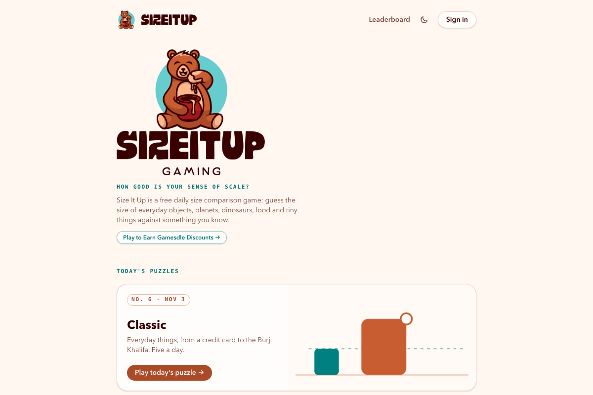
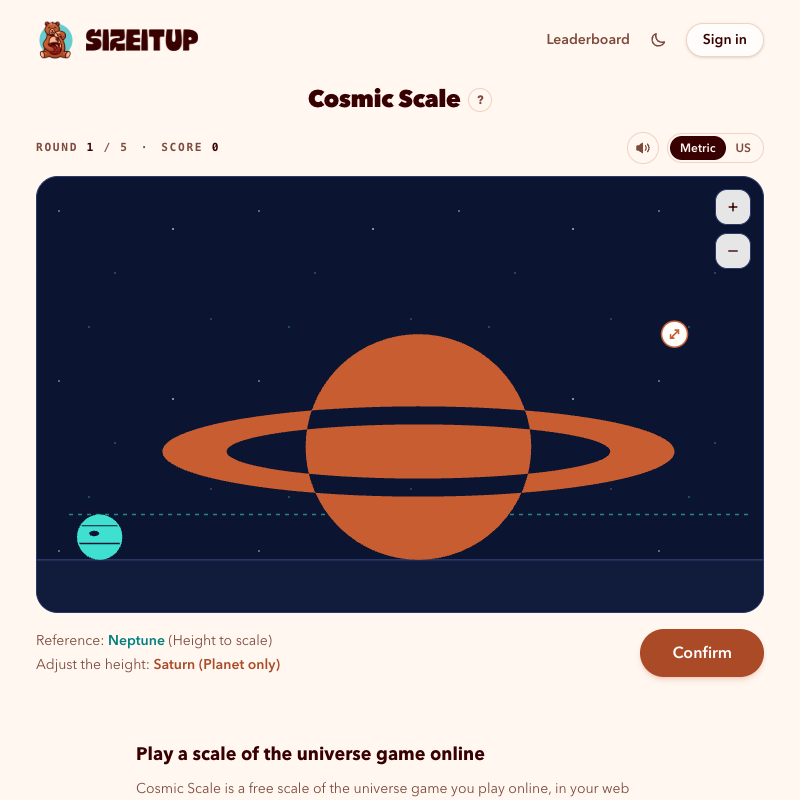
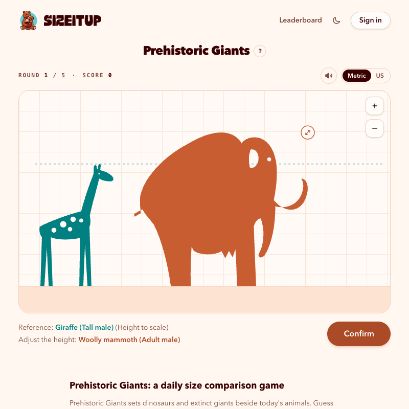
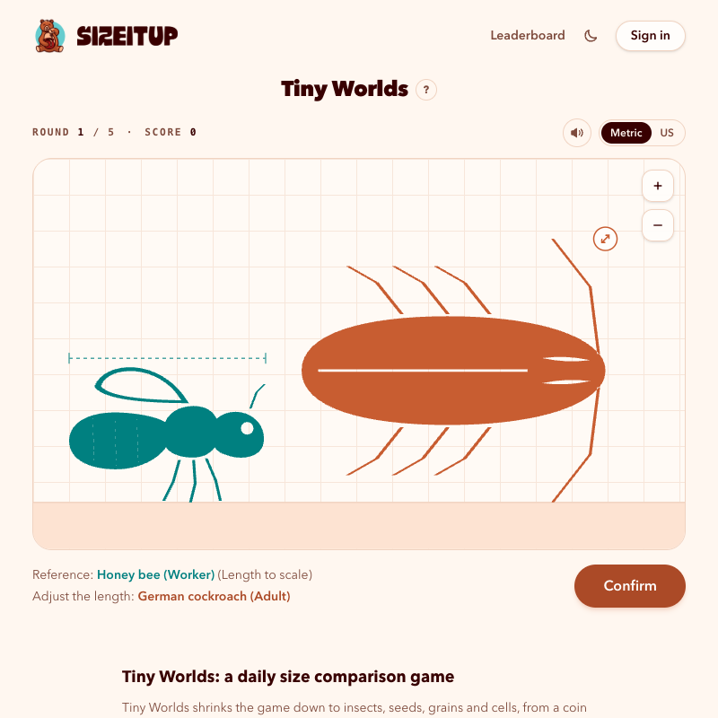
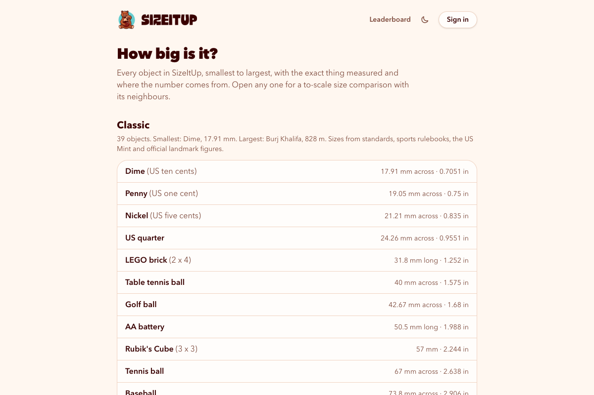

# SizeItUp: the free daily size comparison game

**[SizeItUp](https://sizeitup.us/)** (also written *Size It Up*) is a free daily **size comparison game** in your browser. Each round draws a familiar object at its real size; you stretch a second one until it looks right beside it, then see the true size, where the number comes from and a score out of 100.

How big is Jupiter next to Earth? How many people, lying head to toe, match the length of a T. rex? How many red blood cells fit across a hair? SizeItUp turns sourced, real-world measurements into a quick visual guessing game, and this repository adds **[40 size trivia questions with answers](TRIVIA.md)** drawn from the same data.

### 👉 [Play SizeItUp at sizeitup.us](https://sizeitup.us/)

No download and no ads. Play as a guest straight away, or sign in with Google for the daily leaderboard and streaks across devices.

---

## How to play

1. The **teal** object is drawn at its real size. It's your reference and never changes.
2. Stretch the **orange** object (drag the corner handle, pinch, or use the arrow keys) until it looks the right size beside the teal one.
3. **Confirm** to reveal the true size, a fact about the object and a link to the source of the measurement.
4. Each round scores up to **100 points**, so a day of five rounds is worth up to **500**.

Scoring is about ratios: guessing double and guessing half are equally wrong. Within 6% of the true size scores 100, twice or half the size scores about 33, and five times off or more scores 0.

---

## Five daily games

A new numbered puzzle comes out for every game at midnight in your own timezone, five rounds each.

| Game | What you compare | Sizes come from |
| --- | --- | --- |
| **[Classic](https://sizeitup.us/play)** | 39 everyday objects, from a dime to the Burj Khalifa: coins, balls, paper, sports fields and landmarks | ISO standards, sports governing bodies, the US Mint, official landmark sites |
| **[Cosmic Scale](https://sizeitup.us/play/cosmic)** | 39 planets, moons, stars, asteroids, canyons, mountains and spacecraft | NASA fact sheets and JPL, plus SpaceX and national park services |
| **[Prehistoric Giants](https://sizeitup.us/play/prehistoric)** | 31 dinosaurs and extinct giants beside today's animals | Museum specimens, zoos and peer-reviewed papers |
| **[Kitchen Table](https://sizeitup.us/play/kitchen-table)** | 31 foods and kitchen things, from a peppercorn to a kitchen island | Grading rules, reference works, papers and makers' specifications |
| **[Tiny Worlds](https://sizeitup.us/play/tiny-worlds)** | 32 small things, from a 1-yen coin down to an E. coli bacterium | Health agencies, museums, universities and papers |

  
  
  

---

## More ways to play

- **[Daily leaderboard](https://sizeitup.us/leaderboard):** today's top players and scores for each game. Only signed-in, server-scored rounds count, and players show as anonymous codes.
- **[Free play](https://sizeitup.us/practice):** endless unranked rounds from every game, for practice.
- **[Archive](https://sizeitup.us/archive):** replay any past daily puzzle.
- **[How big is it?](https://sizeitup.us/sizes):** the sourced size of all 172 objects, smallest to largest, with a to-scale comparison page for each one.

---

## Size trivia

**[TRIVIA.md](TRIVIA.md)** has 40 questions with hidden answers, eight per game. Every number comes from SizeItUp's sourced data, and every answer links to the object's page and the source behind its size. A few to try:

- How many Earths would fit side by side across Jupiter?
- Which coin is smaller across: a US dime or a US penny?
- How many Mount Everests tall is Olympus Mons on Mars?
- Was Velociraptor bigger than a person?
- How many red blood cells would fit across the width of a human hair?

The same questions are in **[trivia.json](trivia.json)** for quizzes, classrooms and apps.

---

## Languages

SizeItUp is available in English, [Spanish](https://sizeitup.us/es), [Brazilian Portuguese](https://sizeitup.us/pt-br), [French](https://sizeitup.us/fr), [German](https://sizeitup.us/de) and [Japanese](https://sizeitup.us/ja).

## Contact

SizeItUp is an independent browser game. Questions, ideas or a number that looks off? Write to [support@sizeitup.us](mailto:support@sizeitup.us).

## License

The trivia questions and answers (`TRIVIA.md`, `trivia.json`) are licensed under [CC BY 4.0](LICENSE): reuse them freely with a link to [SizeItUp](https://sizeitup.us/). The SizeItUp name, logo and screenshots are not covered by that license.
